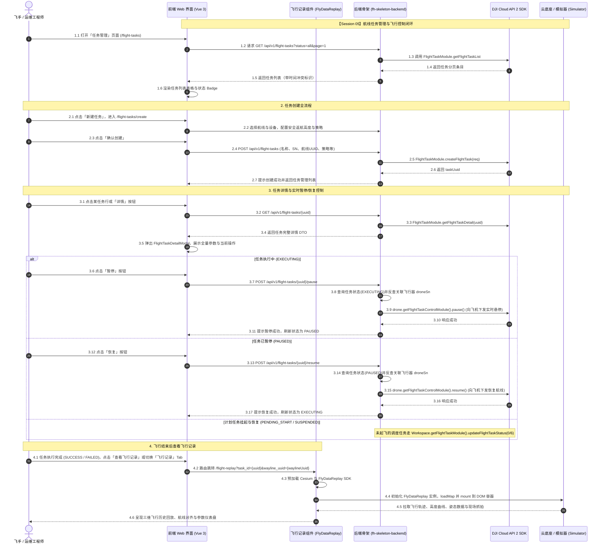
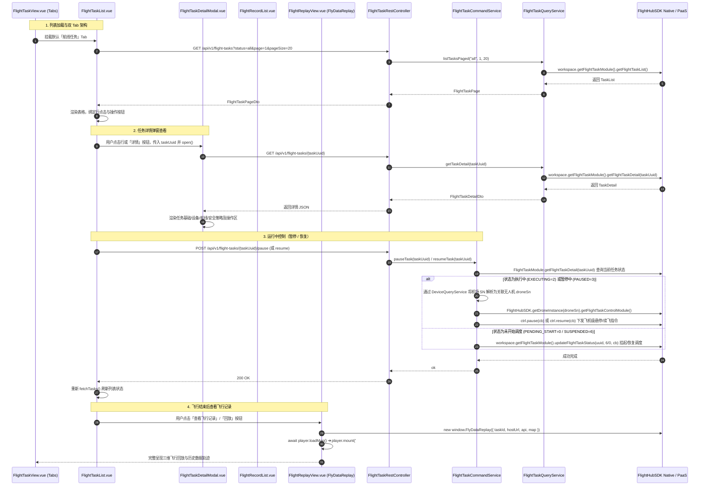

# 大疆上云 API 2 开发者工作坊实战交付规范 (SPEC-03, SPEC-04 & SPEC-05)

依据大疆上云 API 2 开发者工作坊培训大纲，本项目针对 **Session 03（SDK 初始化与设备管理）**、**Session 04（前端独立组件：驾驶舱与航线管理）** 与 **Session 05（任务管理模块与飞行记录组件集成）** 开展系统级工程实现与实战交付。

---

## 一、 需求范围与验收指标对照

### 1.1 Session 03 · SDK 初始化与设备管理
- **核心功能**：
  1. **SDK 事件订阅与双 ListenId 记录**：在 SDK 初始化后订阅**工作空间设备变更**（`listenWorkspaceDeviceChanged`）与**设备拓扑变更**（`listenDeviceTopoChanged`），在后端启动日志与接口中清晰打印/输出这两个 `listenId`；
  2. **设备管理三层接口**：
     - 设备拓扑树接口：`GET /api/v1/devices/topology`（树形结构展示网关/机场与子无人机）；
     - 设备详情接口：`GET /api/v1/devices/{sn}`（单台设备机型、名称、在线状态及最后 OSD 数据）；
     - 机场状态快照接口：`GET /api/v1/devices/{sn}/dock-snapshot`（通过 SDK `getDockDeviceStatus` 获取舱内外温湿度、降雨量、风速、备降点及环境状态）；
     - 监听状态接口：`GET /api/v1/devices/listen-ids`（暴露 `workspaceListenId` 与 `topoListenId`）；
  3. **设备管理 UI（左树右表）**：
     - 页面左侧：展示设备拓扑树（Topology Tree），节点标识 SN、名称、机型、在线状态 Badge，顶部显式展示两个 `listenId`；
     - 页面右侧：
       - 顶部：设备详情基本信息与机场环境状态快照；
       - 中部：实时 OSD 遥测网格字段（经纬度、高度、电量、速度、姿态等，动态刷新）；
       - 底部：OSD 变更历史记录（按时间倒序记录电量、位置等关键遥测字段的变化过程）。
- **验收标准**：
  - [x] 拓扑 SN 与模拟器一致（如 `PFOTS6SUPQQWM6` 机场与 `PF0CSAAT79T5ZCBE50H3` M4TD 无人机）；
  - [x] 后端与前端明确打印并显示两个 `listenId`（`workspaceListenId >= 0`，`topoListenId >= 0`）；
  - [x] 右侧 OSD 字段随设备状态刷新并实时记录变更日志；
  - [x] 启停飞机后 30 秒内通过订阅事件感知状态变更。

### 1.2 Session 04 · 前端独立组件（驾驶舱与航线管理）
- **核心功能**：
  1. **驾驶舱实时画面与自定义按钮**：
     - 基于 `window.FH2.loadCockpit` 建立实时 WebRTC 画面与飞行操控；
     - 顶栏 TopBar 注入自定义按钮：`modules.topBar.features.customButtons`（如「巡检简报」按钮），点击弹出自定义内容浮层；
     - 主画面 leftToolbar 区注入自定义按钮：`modules.mainLive.features.footerItems.customButtons`（如「AI 标注」按钮），点击弹出自定义工具浮层；
  2. **航线管理模块（全流程）**：
     - 航线库列表展示：查看已创建航线列表与详情；
     - 航线创建：启动 `WaylineEditor.create()`，调用地图三维标绘并完成航线保存；
     - 航线修改：启动 `WaylineEditor.render('edit', { waylineId })`，编辑现有航线并保存。
- **验收标准**：
  - [x] 驾驶舱有实时画面且不白屏；
  - [x] 顶栏 TopBar 与主画面 leftToolbar 两处自定义按钮点击后能显示自定义内容模态窗；
  - [x] 航线库能列出航线，并能创建与修改航线。

### 1.3 Session 05 · 任务管理模块与飞行记录组件集成
- **核心功能**：
  1. **航线任务列表展示与多态操作**：
     - 列表展示任务名称、设备 SN、任务 ID/UUID、执行状态 Badge、任务策略类型、创建时间及操作列；
     - 提供状态筛选（全部 / 待执行 / 执行中 / 已暂停 / 成功 / 失败 / 取消等）与分页；
     - 具备实时状态感知与快捷操作：执行中任务提供「暂停」；已暂停任务提供「恢复」；已完成任务（SUCCESS/FAILED）提供「查看飞行记录」；未下发任务提供「编辑」与「删除」；任意任务支持查看「详情」；
  2. **任务创建（Task Creation）**：
     - 提供 `/flight-tasks/create` 航线任务创建流程；
     - 涵盖任务基础信息、从航线库选择航线与三维预览、设备选择（机场）、任务策略（立即/单次定时/重复定时/连续执行）、安全策略（最低起飞电量/返航高度/失联动作）；
     - 支持时间冲突检测与重名拦截校验；
  3. **任务详情（Task Detail Modal）**：
     - 提供专用弹窗/抽屉组件 `FlightTaskDetailModal.vue`，点击列表行或「详情」按钮唤起；
     - 调用后端接口 `GET /api/v1/flight-tasks/{uuid}` 展示任务完整详情参数：基础信息、关联航线名称与 UUID、设备名称与 SN、执行时间窗口、返航高度、失联动作、最低电量、断点续飞状态等；
     - 详情弹窗底部集成当前状态对应的快捷操作按钮（如执行中一键暂停、暂停一键恢复、终态一键查看飞行记录）；
  4. **任务暂停与恢复（Pause & Resume）**：
     - 在列表与详情中均提供高响应度的「暂停」与「恢复」交互；
     - 触发调用后端 `POST /api/v1/flight-tasks/{uuid}/pause` 与 `/resume`，完成任务状态调度并实时刷新前端列表；
  5. **集成前端飞行记录组件（FlyDataReplay Integration）**：
     - 任务管理主页（`FlightTaskView.vue`）升级为双 Tab 结构：
       - **Tab 1: 航线任务**（任务列表、创建、详情与实时控制）；
       - **Tab 2: 飞行记录**（集成 `FlightRecordList.vue` 历史飞行记录列表，可集中查阅与回放）；
     - **飞行结束后查看飞行记录无缝闭环**：
       - 任务在航线任务列表中到达 `SUCCESS` / `FAILED` 状态后，操作列与任务详情内直接提供「查看飞行记录」按钮；
       - 点击直通 `/flight-replay?task_id={taskUuid}&wayline_uuid={waylineUuid}`，唤起基于 `window.FlyDataReplay` 的三维轨迹、姿态仪表、SDR 信号图与参数回放面板。
- **验收标准**：
  - [x] 航线任务列表正常展示，支持状态筛选与分页；
  - [x] 点击「新建任务」可完整配置并下发航线任务；
  - [x] 点击任意任务行或「详情」按钮可唤起任务详情弹窗，完整回显配置与执行参数；
  - [x] 执行中的任务点击「暂停」能成功触发暂停并置为已暂停；已暂停的任务点击「恢复」能继续执行；
  - [x] 页面提供「飞行记录」模块联动，飞行结束后的任务可一键进入飞行记录回放组件。

---

## 二、 阶段一：业务泳道图 (Business Swimlane Flow)

---

## 三、 阶段二：技术架构时序图 (Technical Sequence Diagram)

---

## 四、 核心改动模块清单与最小改动边界

### 4.1 前端工程（`devkit/skeleton/web`）
1. **新建任务详情弹窗组件（[FlightTaskDetailModal.vue](file:///Users/mobai/Downloads/项目信息/大疆/Cloud-API-2/devkit/skeleton/web/src/components/flight-task/FlightTaskDetailModal.vue)）**：
   - 抽屉/模态弹窗形态，展示：任务名称、任务 UUID、状态 Badge、策略类型、执行时间窗口、机场 SN 与名称、航线 UUID 与名称、返航高度、失联动作、最低起飞电量、断点续飞等；
   - 底部集成快捷操作：执行中一键暂停、暂停一键恢复、终态一键查看飞行记录。
2. **重构任务列表组件（[FlightTaskList.vue](file:///Users/mobai/Downloads/项目信息/大疆/Cloud-API-2/devkit/skeleton/web/src/components/flight-task/FlightTaskList.vue)）**：
   - 点击表格行唤起 `FlightTaskDetailModal` 任务详情，替代之前生硬跳转回放的逻辑；
   - 操作列增加「详情」按钮，任何状态均可直接查阅详情；
   - 对已完成任务（`SUCCESS` / `FAILED`）明确展示「查看飞行记录」/「回放」按钮；
   - 完善执行中「暂停」与暂停态「恢复」交互与状态刷新。
3. **升级任务管理页面（[FlightTaskView.vue](file:///Users/mobai/Downloads/项目信息/大疆/Cloud-API-2/devkit/skeleton/web/src/views/FlightTaskView.vue)）**：
   - 升级为双 Tab 视图架构：Tab 1「航线任务」挂载 `FlightTaskList`，Tab 2「飞行记录」挂载 `FlightRecordList`；
   - 用户既能在航线任务列表中直接对已完成任务查看飞行记录，也能在飞行记录 Tab 统一检索回放历史。
4. **前端单测覆盖（[FlightTaskDetailModal.test.ts](file:///Users/mobai/Downloads/项目信息/大疆/Cloud-API-2/devkit/skeleton/web/src/components/flight-task/FlightTaskDetailModal.test.ts) 等）**：
   - 为新增的任务详情组件编写完整的挂载、详情加载、状态展示与按钮事件单元测试；
   - 确保原有 `FlightTaskList.test.ts` 及前端 44 个测试套件 100% 通过。

### 4.2 后端工程（`devkit/skeleton/feature/feature-dashboard`）
1. **后端接口与数据模型核验**：
   - [FlightTaskRestController.java](file:///Users/mobai/Downloads/项目信息/大疆/Cloud-API-2/devkit/skeleton/feature/feature-dashboard/src/main/java/com/dji/fh/feature/dashboard/FlightTaskRestController.java)：已具备 `GET /api/v1/flight-tasks` 分页列表、`POST` 创建、`GET /{uuid}` 详情、`POST /{uuid}/pause` 暂停、`POST /{uuid}/resume` 恢复等全量接口；
   - [FlightTaskQueryService.java](file:///Users/mobai/Downloads/项目信息/大疆/Cloud-API-2/devkit/skeleton/feature/feature-dashboard/src/main/java/com/dji/fh/feature/dashboard/spi/FlightTaskQueryService.java) 与 [FlightTaskCommandService.java](file:///Users/mobai/Downloads/项目信息/大疆/Cloud-API-2/devkit/skeleton/feature/feature-dashboard/src/main/java/com/dji/fh/feature/dashboard/spi/FlightTaskCommandService.java)：契约完备，已覆盖 Mock 与 SDK 两套实现，252 个后端单测全部通过。
2. **航线任务实时控制重构（修复 `task status can not update` 异常）**：
   - 彻底剥离工作空间计划状态更新与运行中无人机控制逻辑：
     - **运行中飞机控制（EXECUTING=2 / PAUSED=3）**：通过 `DeviceQueryService` 将任务关联的机场 SN 解析为无人机 `droneSn`，调用 `FlightHubSDK.getDroneInstance(droneSn).getFlightTaskControlModule()` 的 `pause(callback)` 与 `resume(callback)` 方法，发送非实时指令至飞行器执行空中悬停与恢复；
     - **未起飞计划调度（PENDING_START=0 / SUSPENDED=6）**：继续通过 `Workspace.getFlightTaskModule().updateFlightTaskStatus(uuid, 6/0, callback)` 挂起或激活调度；
   - 改造 [SdkFlightTaskCommandService.java](file:///Users/mobai/Downloads/项目信息/大疆/Cloud-API-2/devkit/skeleton/feature/feature-dashboard/src/main/java/com/dji/fh/feature/dashboard/spi/sdk/SdkFlightTaskCommandService.java) 及 [SdkDashboardAutoConfiguration.java](file:///Users/mobai/Downloads/项目信息/大疆/Cloud-API-2/devkit/skeleton/feature/feature-dashboard/src/main/java/com/dji/fh/feature/dashboard/spi/sdk/SdkDashboardAutoConfiguration.java)，注入 `DeviceQueryService`；
   - 更新 [SdkFlightTaskCommandServiceTest.java](file:///Users/mobai/Downloads/项目信息/大疆/Cloud-API-2/devkit/skeleton/feature/feature-dashboard/src/test/java/com/dji/fh/feature/dashboard/spi/sdk/SdkFlightTaskCommandServiceTest.java) 单元测试用例，覆盖状态分流、飞机级控制与异常降级分支。

### 4.3 设备管理路由与测试服务器联调（`devkit/skeleton/web`）
1. **路由正名（[src/router/index.ts](file:///Users/mobai/Downloads/项目信息/大疆/Cloud-API-2/devkit/skeleton/web/src/router/index.ts)）**：
   - 将 `/devices` 路由组件直接绑定为 Session 03 的 `DevicesView.vue`，彻底消除底座 PaaS SDK 优先劫持导致的旧版页面问题；
   - 保留 `/devices-sdk` 路由指向 `DeviceManagerView.vue`，支持需要时独立访问底座官方 UMD SDK 界面；
   - 保持 `/device-manager` 重定向至 `/devices`；
2. **测试服务器数据对接与平滑兜底（[src/api/devices.ts](file:///Users/mobai/Downloads/项目信息/大疆/Cloud-API-2/devkit/skeleton/web/src/api/devices.ts) / [src/views/DevicesView.vue](file:///Users/mobai/Downloads/项目信息/大疆/Cloud-API-2/devkit/skeleton/web/src/views/DevicesView.vue)）**：
   - 确保 `DevicesView.vue` 无论在测试服务器已连接真实机场/无人机，还是在测试服务器仅运行基础服务时，均能正确读取后端设备拓扑与快照，未返回时优雅呈现高可用示范拓扑；
   - 保证实时 OSD 遥测网格与变更流水日志在测试服务器环境下均能动态感知与呈现。

---

## 五、 纯本地运行模式缺失功能与后续完善清单（Gap & Roadmap）

当前项目已移除失效远程测试服务器依赖，仅保留本地环境运行（后端 `FH_SKELETON_PROFILE=mock` + 本地 MySQL `fh_skeleton`，前端 Vite `5173`）。为便于后续二开与功能补齐，以下梳理**已修复的路由切换问题**及**各模块当前缺失功能与具体完善方向**：

### 5.1 已知路由切换白屏修复记录
- **现象**：部分页面从顶部导航点击进入后内容为空，手动刷新页面后恢复显示。
- **根因**：[App.vue](file:///Users/mobai/Downloads/项目信息/大疆/Cloud-API-2/devkit/skeleton/web/src/App.vue) 的 `<router-view>` 外层包裹了 `<Transition name="page" mode="out-in">`，Vue 3 要求 `<Transition>` 的直接子组件必须为**单根元素**；而 [CockpitView.vue](file:///Users/mobai/Downloads/项目信息/大疆/Cloud-API-2/devkit/skeleton/web/src/views/CockpitView.vue) 与 [WaylineView.vue](file:///Users/mobai/Downloads/项目信息/大疆/Cloud-API-2/devkit/skeleton/web/src/views/WaylineView.vue) 模板顶层存在 `v-if`/`v-else` 多根节点及顶层 HTML 注释（编译为 Fragment），导致路由切换过渡卡死白屏。
- **修复**：已为 `CockpitView.vue`（`.cockpit-root`）与 `WaylineView.vue`（`.wayline-root`）补充唯一根容器元素，同时在 [AppTopNav.vue](file:///Users/mobai/Downloads/项目信息/大疆/Cloud-API-2/devkit/skeleton/web/src/components/AppTopNav.vue) 中解锁了此前被锁定的 4 个入口菜单。

### 5.2 各功能模块缺失项与完善清单

| 模块 / 路由 | 当前本地运行现状 | 缺失功能 | 具体需要完善的内容 |
| :--- | :--- | :--- | :--- |
| **直播大屏** `/live-stream` | 宫格布局、OSD/填充模式切换与日志面板可用；无 FH2 PaaS 时提示「初始化失败」 | 1. 实时视频流播放能力 2. 在线设备快捷列表 | 1. **接入流媒体/底座**：配置真实 `VITE_FH2_ADDRESS`（对接 `DJILivePlayer` SDK），或在本地开发态基于 Oryx / SRS（WHEP/WebRTC）或示例 `<video>` 流实现 `useLivePlayer.ts` 本地兜底播放器。 2. **设备面板联动**：`LiveDevicePanel.vue` 补充从 `GET /api/v1/devices` 拉取在线设备列表供点击选流，替代手工输入 SN。 |
| **设备管理** `/devices` | 左树右表、双 `listenId`、机场快照、OSD 网格与变更流水 UI 完整，当前依赖前端示范数据兜底 | 1. 后端拓扑树与快照接口 2. 实时变更推送链路 | 1. **补齐后端接口**：[DeviceRestController.java](file:///Users/mobai/Downloads/项目信息/大疆/Cloud-API-2/devkit/skeleton/feature/feature-device/src/main/java/com/dji/fh/feature/device/DeviceRestController.java) 目前仅提供 `GET /api/v1/devices` 与 `/{sn}`，需补齐前端已对接的 `GET /api/v1/devices/listen-ids`、`GET /api/v1/devices/{sn}/dock-snapshot` 及 `GET /api/v1/devices/topology`。 2. **对齐 Mock 与推送**：统一 `MockDeviceRegistry` 设备 SN 与拓扑层级，并通过 WebSocket 主动推送 OSD/拓扑变更，替代纯定时轮询。 |
| **驾驶舱** `/cockpit` | 设备选择页与「数字孪生 FOV 驾驶舱」（Cesium）可打开；「官方标准驾驶舱」与「设备小窗」依赖 FH2 PaaS | 1. 标准驾驶舱离线操控 2. 自定义弹窗真实业务数据 3. 数字孪生模拟推流 | 1. **弹窗业务化**：[CockpitView.vue](file:///Users/mobai/Downloads/项目信息/大疆/Cloud-API-2/devkit/skeleton/web/src/views/CockpitView.vue) 中「巡检简报」与「AI 标定」当前为静态示范数据，且「保存并下发标定标注」仅关闭弹窗，需对接后端任务进度、电池 SOH、AI 识别与标定下发接口。 2. **本地飞控与视频替代**：无 FH2 PaaS 时补充独立起降/返航/云台控制面板（调用 SDK Control 接口）与本地视频窗口。 3. **Mock 遥测驱动**：在 `feature-sei-osd` 增加 Mock SEI/OSD 轨迹生成器，使本地无真机时数字孪生视口也能动起来。 |
| **航线编辑器 / 航线库** `/wayline` | 航线库列表 UI 可打开；创建/编辑（`?mode=create\|edit`）与「拼接航线」依赖 FH2 PaaS `WaylineEditor` | 1. 本地 `.kmz` 持久化与 CRUD 2. 离线航线标绘与拼接 | 1. **后端持久化**：[WaylineService.java](file:///Users/mobai/Downloads/项目信息/大疆/Cloud-API-2/devkit/skeleton/feature/feature-wayline/src/main/java/com/dji/fh/feature/wayline/WaylineService.java) 默认实现返回空列表，导入/下载/删除均为日志空操作；需新增本地/MySQL/对象存储实现，真正解析并存储 `.kmz` 文件（可预置导入根目录 `standard_patrol_wayline.kmz`）。 2. **离线编辑器**：基于 Cesium 实现本地航点绘制、三维预览与 KMZ 打包导出，解除对 `window.WaylineEditor` 的强绑定。 |
| **任务管理与飞行记录** `/flight-tasks` `/flight-replay` | 任务列表、创建表单、详情弹窗及「飞行记录」Tab 可正常交互 | 1. Mock 任务命令持久化 2. 离线三维飞行回放 | 1. **有状态 Mock 调度**：[MockFlightTaskCommandService.java](file:///Users/mobai/Downloads/项目信息/大疆/Cloud-API-2/devkit/skeleton/feature/feature-dashboard/src/main/java/com/dji/fh/feature/dashboard/spi/MockFlightTaskCommandService.java) 的增删改及执行/暂停/恢复/取消目前只打日志不改数据，需改为持久化到 MySQL 或可状态流转的内存仓库。 2. **本地轨迹回放**：[FlightReplayView.vue](file:///Users/mobai/Downloads/项目信息/大疆/Cloud-API-2/devkit/skeleton/web/src/views/FlightReplayView.vue) 回放模式强依赖 `window.FlyDataReplay`，需补充基于 Cesium 的本地轨迹/高度曲线回放兜底。 |
| **媒体管理** `/media` | 列表、筛选与工具栏 UI 可打开，但数据为空 | 1. 媒体列表、预览与下载删除 | [MediaService.java](file:///Users/mobai/Downloads/项目信息/大疆/Cloud-API-2/devkit/skeleton/feature/feature-media/src/main/java/com/dji/fh/feature/media/MediaService.java) 在非 SDK 模式下固定返回空列表与空下载 URL，需补充本地文件库或 Mock 媒体资源服务以支持缩略图预览、下载与删除。 |
| **模型库** `/models` | `MockTerraService` 提供模拟文件夹、任务与质量报告展示 | 1. 真实模型下载 2. 本地 3D Tiles 资源服务 | [ModelsView.vue](file:///Users/mobai/Downloads/项目信息/大疆/Cloud-API-2/devkit/skeleton/web/src/views/ModelsView.vue) 第 107 行明确提示模型下载暂不支持；需补齐真实 SDK/对象存储下载链接及本地静态 3D Tiles 样例服务。 |
| **空域管理** `/flight-areas` | 已接入 MySQL JPA（`t_flight_area`），本地增删改查完整持久化 | 1. 设备侧空域下发与告警联动 | 在 `sdk` 模式下需完善将数据库空域同步至机场/无人机及禁飞区冲突告警闭环。 |
| **数据看板** `/` | Mock 模式下展示模拟资产、任务分布与地图标注 | 1. 真实业务库聚合统计 | 将 `MockMediaCountService`、`MockModelCountService`、`MockPersonnelCountService` 替换为基于真实业务表与航线/任务/媒体模块的实时聚合查询。 |
